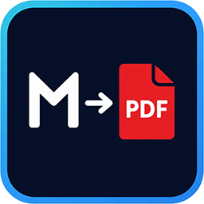
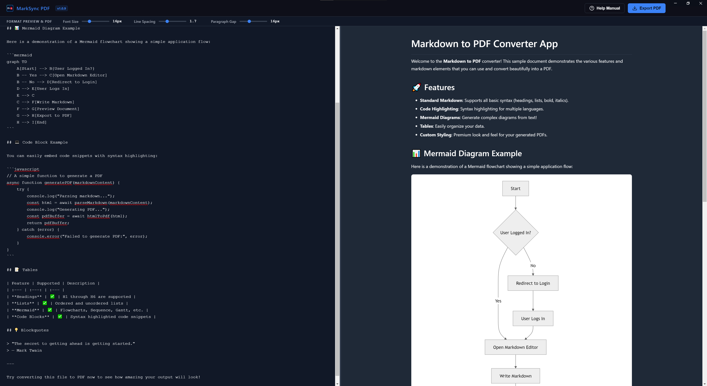
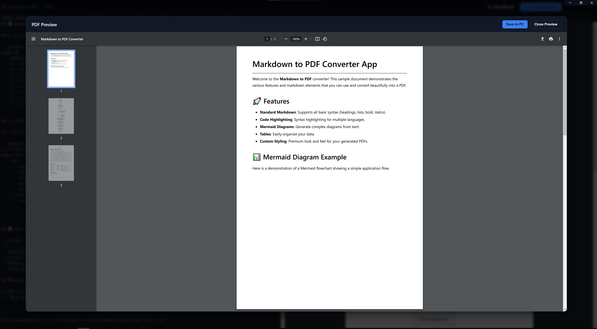

<div align="center">
  
  <h1>MarkSync PDF</h1>
  <p>
    <strong>A fast, modern desktop Markdown-to-PDF studio built with Electron.</strong><br />
    Live split-pane editing, real-time typography controls, KaTeX math, Mermaid diagrams, GitHub alerts, and print-ready A4 PDF export.
  </p>
  <p>
    <a href="https://jctool.itch.io/marksync-pdf">Download / itch.io</a> •
    <a href="#demo">Demo</a> •
    <a href="#features">Features</a> •
    <a href="#getting-started">Getting Started</a> •
    <a href="#building-for-windows">Building</a> •
    <a href="USER_MANUAL.md">User Manual</a>
  </p>
</div>

---

## Overview

**MarkSync PDF** (`v1.2.8`) is a Windows-focused Electron desktop application that turns Markdown documents into clean, publication-ready PDFs. Write or drop a `.md` / `.txt` file on the left, fine-tune typography in real time from the toolbar, inspect the rendered A4 output in an interactive PDF preview modal, and save straight to disk.

<p align="center">
  
</p>

---

## Demo

<p align="center">
  <a href="https://youtu.be/kvczMZdUnWw" target="_blank">
    
  </a>
  <br />
  <sub>Click the thumbnail above to watch the demo video on YouTube.</sub>
</p>

---

## Features

- **Live Split-Pane Workspace** — Resizable side-by-side Markdown editor and rendered preview with automatic local persistence (`localStorage`).
- **Off-Main-Thread Parsing** — Runs `marked`, `highlight.js`, and `KaTeX` inside a dedicated Web Worker (`parseWorker.js`) with adaptive debouncing (`80ms`–`350ms`) so typing stays responsive even on large documents.
- **Bi-Directional Synchronized Scrolling** — `requestAnimationFrame`-throttled proportional scrolling keeps the editor and preview panes aligned in both directions.
- **Dynamic Typography Controls** — Adjust layout live in the preview and carry it directly into the exported PDF:
  - **Font Size** (`12px` – `28px`)
  - **Title Size** (`1.2em` – `3.5em`)
  - **Line Spacing** (`1.2` – `3.0`)
  - **Paragraph Gap** (`4px` – `40px`)
  - **Hide Table Borders** toggle for minimalist tables
- **Rich Markdown Support**:
  - **Code Blocks:** Multi-language syntax highlighting via `highlight.js` (Atom One Dark theme) with one-click copy buttons.
  - **LaTeX Math:** Inline (`$...$`) and block (`$$...$$`) equations rendered with `KaTeX`.
  - **Mermaid Diagrams:** Lazy-loaded `mermaid` rendering for flowcharts, sequence diagrams, and more.
  - **GitHub-Style Alerts:** Native styling and icons for `[!NOTE]`, `[!TIP]`, `[!IMPORTANT]`, `[!WARNING]`, and `[!CAUTION]`.
  - **Tables & Task Lists:** Column alignment support and `- [x]` / `- [ ]` checklists.
- **Interactive PDF Preview & Export** — Generates an A4 PDF via Chromium `printToPDF` (`12mm 18mm` page margins, editor chrome hidden via `@media print`), displays it in an in-app `<webview>` modal, and lets you save via the native file dialog while automatically cleaning up temporary files.
- **Drag-and-Drop Import** — Drop any `.md` or `.txt` file onto the window to load it immediately.
- **Built-in Help Manual** — Opens `USER_MANUAL.md` inside a cached in-app modal with rendered syntax examples and diagrams.

<p align="center">
  
</p>

---

## Tech Stack

| Component | Technology |
| :--- | :--- |
| Desktop Runtime | [Electron](https://www.electronjs.org/) (`^30.0.0`) |
| Markdown Parser | [marked](https://marked.js.org/) (`^12.0.2`) |
| Syntax Highlighting | [highlight.js](https://highlightjs.org/) (`^11.9.0`) |
| Math Typesetting | [KaTeX](https://katex.org/) (`^0.16.10`) |
| Diagrams | [Mermaid](https://mermaid.js.org/) (`^11.16.0`) |
| Packaging | [electron-builder](https://www.electron.build/) (`^24.13.3`) |

---

## Getting Started

### Prerequisites

- [Node.js](https://nodejs.org/) (LTS recommended) and `npm`

### Run from Source

```bash
# Clone the repository
git clone https://github.com/Nastomeya/MarkSync-PDF.git
cd MarkSync-PDF

# Install dependencies
npm install

# Launch the app
npm start
```

---

## Building for Windows

The project is configured with `electron-builder` to produce an NSIS Windows installer (`Install.exe`) in the `dist/` directory:

```bash
npm run build
```

> [!NOTE]
> `build/installer.nsh` automatically closes any running `MarkSync PDF.exe` process before installation/updates to prevent file-lock dialogs, and `main.js` enforces a single-instance lock alongside stale GPU/HTTP cache cleanup.

---

## Project Structure

```text
MarkSync-PDF/
├── main.js            # Electron main process, splash screen, single-instance lock, PDF IPC handlers
├── preload.js         # Preload script exposing Electron APIs
├── index.html         # Main application layout, toolbar sliders, editor/preview panes, modals
├── splash.html        # Startup splash screen with failsafe transition timers
├── renderer.js        # UI logic, sync scroll, Web Worker coordination, Mermaid, drag-and-drop, PDF modal
├── parseWorker.js     # Web Worker for off-thread marked + highlight.js + KaTeX parsing
├── styles.css         # App theme, Markdown styling, alerts, and @media print PDF rules
├── USER_MANUAL.md     # In-app user manual and Markdown syntax reference
├── LICENSE            # Proprietary license (All Rights Reserved)
├── package.json       # Dependencies, scripts, and electron-builder configuration
├── assets/            # App icons and branding assets
├── build/             # Windows installer icons and NSIS script (installer.nsh)
└── Resources/         # Demo Markdown file, cover artwork, and screenshots
```

---

## License

Copyright © 2026 **JCTool**. **All Rights Reserved.**

This project is proprietary software (`"license": "UNLICENSED"` in `package.json`). You may **not** copy, modify, redistribute, repackage, or sell the source code or compiled binaries without prior written permission. See [LICENSE](LICENSE) for full terms, or obtain an official licensed copy at [jctool.itch.io/marksync-pdf](https://jctool.itch.io/marksync-pdf).
