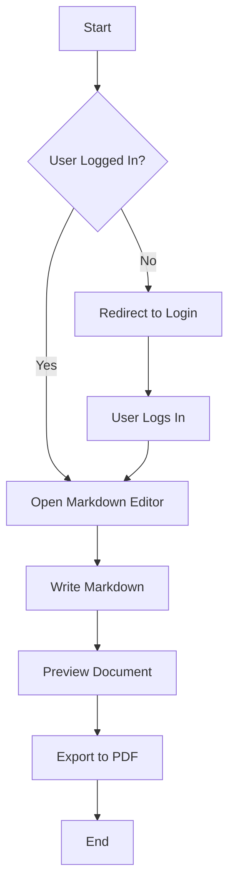

# Markdown to PDF Converter App

Welcome to the **Markdown to PDF** converter! This sample document demonstrates the various features and markdown elements that you can use and convert beautifully into a PDF.

## 🚀 Features

- **Standard Markdown**: Supports all basic syntax (headings, lists, bold, italics).
- **Code Highlighting**: Syntax highlighting for multiple languages.
- **Mermaid Diagrams**: Generate complex diagrams from text!
- **Tables**: Easily organize your data.
- **Custom Styling**: Premium look and feel for your generated PDFs.

## 📊 Mermaid Diagram Example

Here is a demonstration of a Mermaid flowchart showing a simple application flow:



## 💻 Code Block Example

You can easily embed code snippets with syntax highlighting:

```javascript
// A simple function to generate a PDF
async function generatePDF(markdownContent) {
    try {
        console.log("Parsing markdown...");
        const html = await parseMarkdown(markdownContent);
        console.log("Generating PDF...");
        const pdfBuffer = await htmlToPdf(html);
        return pdfBuffer;
    } catch (error) {
        console.error("Failed to generate PDF:", error);
    }
}
```

## 📝 Tables

| Feature | Supported | Description |
| :--- | :---: | :--- |
| **Headings** | ✅ | H1 through H6 are supported |
| **Lists** | ✅ | Ordered and unordered lists |
| **Mermaid** | ✅ | Flowcharts, Sequence, Gantt, etc. |
| **Code Blocks** | ✅ | Syntax highlighted code snippets |

## 💡 Blockquotes

> "The secret to getting ahead is getting started."
> — Mark Twain

---

Try converting this file to PDF now to see how amazing your output will look!
