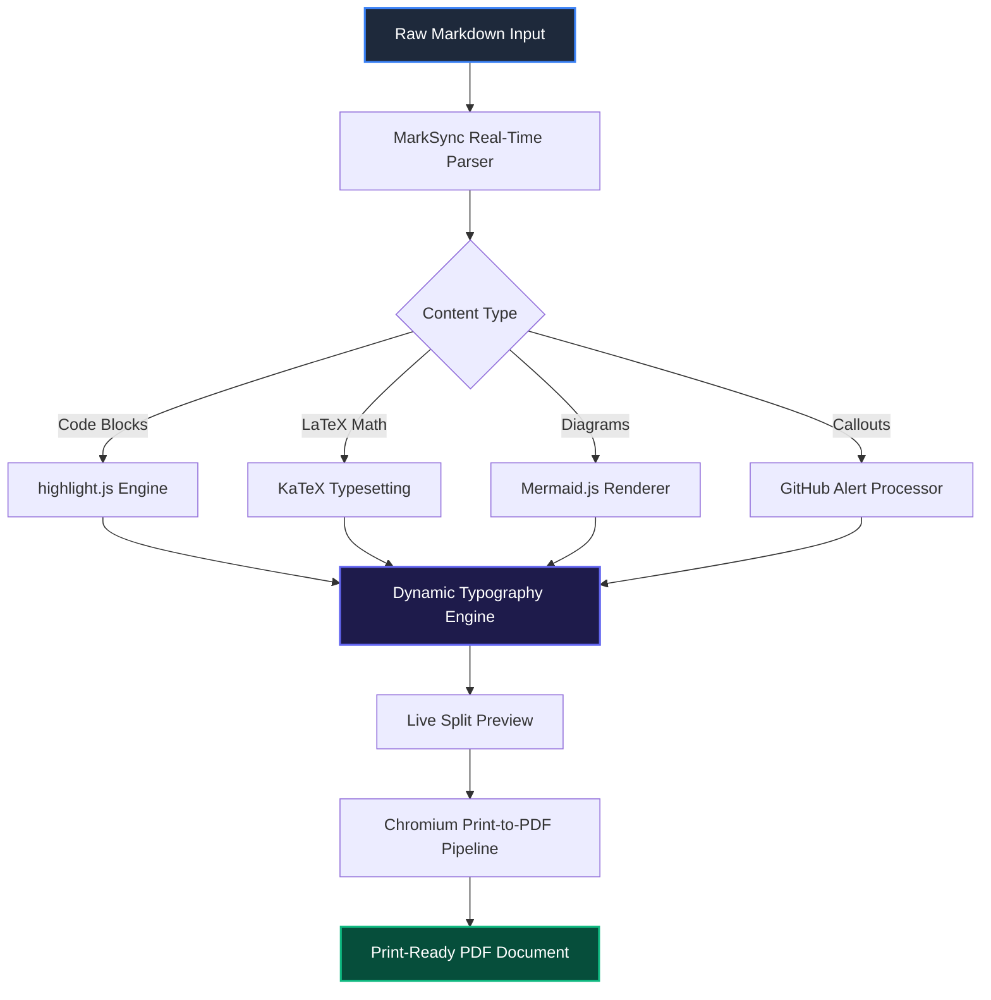
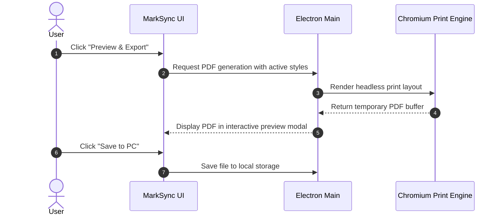

# MarkSync PDF — User Manual & Reference Guide 🚀

Welcome to **MarkSync PDF**, a modern desktop studio designed to convert Markdown documents into publication-ready, professional PDF files. MarkSync PDF combines a live split-view editor with dynamic typography sliders, KaTeX mathematical typesetting, Mermaid diagram generation, GitHub-style callouts, and pixel-perfect Chromium PDF export.

---

## 1. Key Features & Capabilities

* **Real-Time Split-Pane Workspace:** Distraction-free editing on the left with instant, synchronized rendering on the right.
* **Dynamic Typography Controls:** Real-time toolbar sliders for **Font Size**, **Title Size**, **Line Spacing**, and **Paragraph Gaps** with immediate preview feedback and PDF carry-over.
* **Table Border Customization:** Easily toggle between bordered and clean borderless table layouts.
* **Built-in Synchronized Split Scrolling:** Seamless bi-directional synchronized scrolling keeps the editor and rendered preview panes in perfect alignment as you write or scroll.
* **One-Click Syntax Copy:** Instant copy buttons on every code block and syntax template for rapid learning and pasting.
* **Drag-and-Drop File Import:** Drop any `.md` or `.txt` file onto the window to open its contents instantly.
* **Advanced Markdown Formatting:**
  * **Code Blocks:** Multi-language syntax highlighting powered by *highlight.js*.
  * **LaTeX Mathematics:** High-speed inline (`$...$`) and block (`$$...$$`) math equations powered by *KaTeX*.
  * **Mermaid Diagrams:** Vector-rendered flowcharts, sequence diagrams, state charts, and class diagrams.
  * **GitHub-Style Alerts:** Distinct callout boxes (`[!NOTE]`, `[!TIP]`, `[!IMPORTANT]`, `[!WARNING]`, `[!CAUTION]`).
  * **Task Checklists:** Interactive task checkboxes (`[x]` and `[ ]`).
* **Standalone Print-Ready PDF:** Hides editor controls, generates crisp vector graphics, and preserves styling in standalone PDF output.
* **Smart Page Breaks:** Automatically prevents headers, code blocks, tables, and diagrams from breaking awkwardly across page seams.

---

## 2. Getting Started & How to Use

### Writing and Importing Content
1. **Type directly** into the left editor pane. The preview pane on the right updates instantaneously with zero input lag.
2. **Automatic Synchronized Scrolling:** As you scroll through the editor, the preview automatically scrolls to match your position in the document (and vice-versa), so you always see the corresponding rendered output immediately.
3. **Drag & Drop:** Drag any `.md` or `.txt` file from Windows Explorer and drop it anywhere over the application window to load it.
4. **Auto-Save:** Your current document is automatically preserved locally across application sessions.

### Adjusting Layout with Dynamic Sliders
Use the **Format Preview** toolbar at the top of the window to fine-tune your document layout:
* **Font Size Slider (`12px` – `28px`):** Scales the base body text size.
* **Title Size Slider (`1.2em` – `3.5em`):** Adjusts heading scale proportionally from `H1` down to `H4`.
* **Line Spacing Slider (`1.2` – `3.0`):** Fine-tunes line height for compact or airy reading.
* **Paragraph Gap Slider (`4px` – `40px`):** Modulates vertical breathing room between paragraphs, tables, quotes, and code blocks.
* **Hide Table Borders:** Check this box for minimalist, borderless tables.

### Previewing and Exporting to PDF
1. Click the **Preview & Export** button in the top-right corner.
2. A high-resolution PDF will be rendered and shown in the native preview overlay modal.
3. If everything looks balanced, click **Save to PC** to choose your save location.
4. Click **Close Preview** to return to editing.

---

## 3. Application Workflow & Architecture

The diagram below illustrates how MarkSync PDF transforms your Markdown content into a clean PDF:



### Export Pipeline Sequence



---

## 4. Markdown Syntax & Features Cheat Sheet

> [!TIP]
> **Quick Learning Shortcut:** Click the **Copy** icon button in the top-right corner of any syntax box below to instantly copy the raw Markdown example directly to your clipboard!

### GitHub-Style Alerts & Callouts

MarkSync PDF natively renders all five GitHub alert types with custom icons and styled borders:

> [!NOTE]
> Useful background information that users should know.

> [!TIP]
> Helpful advice or shortcuts to improve productivity.

> [!IMPORTANT]
> Crucial information required to achieve your goal.

> [!WARNING]
> Urgent info that needs immediate attention to prevent problems.

> [!CAUTION]
> Advises about potential risks, hazards, or negative outcomes.

#### Alert Syntax:
```markdown
> [!NOTE]
> Useful background information.

> [!TIP]
> Helpful advice or shortcuts.

> [!IMPORTANT]
> Key information you should know.

> [!WARNING]
> Warning about potential issues.

> [!CAUTION]
> Critical caution regarding risks.
```

---

### LaTeX Mathematical Equations (KaTeX)

Write inline formulas with single dollar signs `$ ... $` or centered display equations with double dollar signs `$$ ... $$`.

#### Live Formula Examples:
* **Inline Math:** The Euler identity $e^{i\pi} + 1 = 0$ and limit $\lim_{x \to 0} \frac{\sin x}{x} = 1$.
* **Gaussian Normal Distribution:**
$$f(x \mid \mu, \sigma^2) = \frac{1}{\sigma \sqrt{2\pi}} \exp\left( -\frac{(x - \mu)^2}{2\sigma^2} \right)$$

* **Definite Integral & Series:**
$$\int_{a}^{b} x^2 \, dx = \left[ \frac{x^3}{3} \right]_{a}^{b}, \quad \sum_{n=1}^{\infty} \frac{1}{n^2} = \frac{\pi^2}{6}$$

* **Coordinate Transformation Matrix:**
$$\begin{pmatrix} x' \\ y' \\ 1 \end{pmatrix} = \begin{bmatrix} \cos\theta & -\sin\theta & t_x \\ \sin\theta & \cos\theta & t_y \\ 0 & 0 & 1 \end{bmatrix} \begin{pmatrix} x \\ y \\ 1 \end{pmatrix}$$

#### Math Syntax:
```markdown
Inline formula: $E = mc^2$

Block equation:
$$
f(x) = \int_{-\infty}^{\infty} \hat{f}(\xi)\,e^{2 \pi i \xi x}\,d\xi
$$
```

---

### Mermaid Diagrams

Generate visual diagrams by labeling code blocks with `mermaid`. MarkSync PDF supports flowcharts, sequence diagrams, state diagrams, class diagrams, and more.

#### 1. Linear Process Flowchart (Left-to-Right)


##### Syntax:
````markdown

````

#### 2. Advanced Multi-Branch Flowchart (Top-to-Down)


##### Syntax:
````markdown

````

---

### Code Blocks & Syntax Highlighting

Write inline code with single backticks, or create multi-line code blocks with triple backticks and a language identifier (such as `javascript`, `python`, `html`, `css`, `bash`, `json`, `sql`, etc.) for syntax highlighting powered by *highlight.js*:

#### Live Code Examples:

```javascript
// Synchronizing typography variables with DOM
function setDocumentTheme(fontSize, lineHeight) {
  const container = document.getElementById('previewOutput');
  container.style.setProperty('--md-font-size', `${fontSize}px`);
  container.style.setProperty('--md-line-height', lineHeight);
}
```

```python
# Batch export script
import pathlib

def find_markdown_files(directory: str) -> list[str]:
    """Return all Markdown files in a directory."""
    return [str(p) for p in pathlib.Path(directory).glob("*.md")]
```

#### Code Block Syntax:
````markdown
Inline code: `const appVersion = "1.2.5";`

Multi-line block with language identifier:
```javascript
function greet(name) {
  console.log(`Hello, ${name}!`);
}
```

```python
def calculate_total(items: list[float]) -> float:
    return sum(items)
```
````

---

### Tables & Column Alignment

Format structured data using pipes (`|`) and hyphens (`-`). Use colons (`:`) in the separator row to control text alignment (`:---` for left, `:---:` for center, and `---:` for right). Toggle **Hide Table Borders** in the toolbar for minimalist tables.

#### Live Table Result:

| Header 1 (Left) | Header 2 (Center) | Header 3 (Right) |
| :--- | :---: | ---: |
| Left-aligned text | Centered value | $100.00 |
| Sample item A | Active | $250.50 |
| Sample item B | Completed | $75.00 |

#### Table Syntax:
```markdown
| Header 1 (Left) | Header 2 (Center) | Header 3 (Right) |
| :--- | :---: | ---: |
| Left-aligned text | Centered value | $100.00 |
| Sample item A | Active | $250.50 |
| Sample item B | Completed | $75.00 |
```

---

### Task Checklists

Create interactive task checklists using `- [x]` for checked items and `- [ ]` for unchecked items:

#### Live Checklist Result:

- [x] Completed task item
- [ ] Unfinished task item
- [ ] Next milestone item

#### Checklist Syntax:
```markdown
- [x] Completed task item
- [ ] Unfinished task item
- [ ] Next milestone item
```

---

## 5. Pro Tips & Best Practices for PDF Export

1. **Avoid Orphaned Headings:** If a heading appears near the very bottom of a page, increase the **Paragraph Gap** slider slightly. This will smoothly push the heading to the top of the next page.
2. **Table Density:** For wide tables, decrease the **Font Size** slider to `14px` or `15px` to keep all columns comfortably within the printable margins.
3. **Diagram Sizing:** Keep Mermaid diagrams focused and use `flowchart TD` or `flowchart LR` orientation for optimal fit on standard portrait A4 / Letter pages.
4. **Valid Math & Mermaid Syntax:** If a diagram or formula shows an error message, check for missing closing brackets or unescaped characters.
